# Fields Workbench

> [!WARNING]
> **Active Development:** This workbench is an experimental work in progress. Tools, underlying data structures, and file storage formats are subject to change. **Backwards compatibility is not guaranteed** across updates.

The **Fields Workbench** is an implicit modeling workbench for FreeCAD, built on Signed Distance Fields (SDF). Traditional CAD tools work on boundary representations (B-Rep) and polygon meshes. Fields evaluates shapes as continuous 3D volumetric fields instead. This allows real-time volumetric booleans, procedural surface displacement with noise, and spatial deformations directly in FreeCAD, with tools to extract native 2D curves or polygon meshes for downstream workflows.

## Tools

### Point

Places a point in the view. Shortcut: `P`.

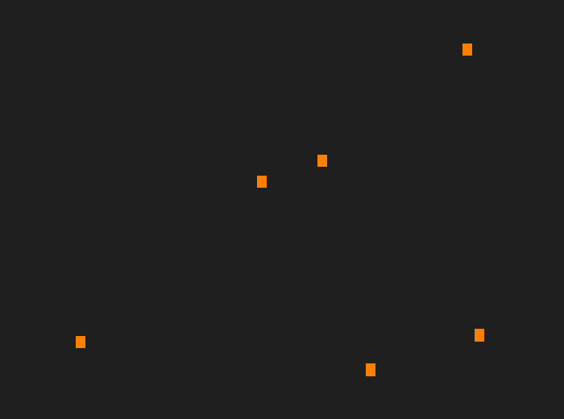

### Curve

Creates a curve through the points you click in the view. Supports 2D and 3D curves.

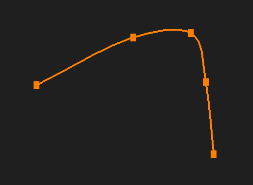

### Work Plane

Places a permanent work plane object. New geometry is created on a visible work plane. Shortcut: `W`.

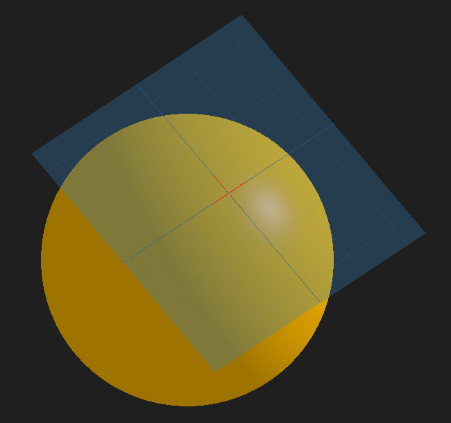

### Fill Curve

Creates an SDF face that fills a closed curve. Select the closed curve first. Shortcut: `Ctrl+F`.

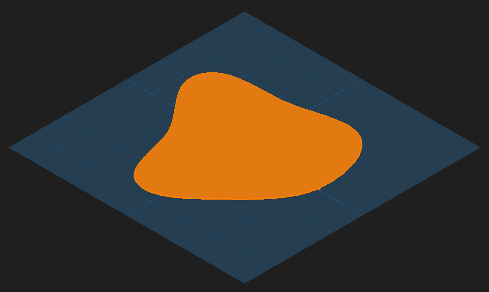

### Extrude

Extrudes an SDF face into a solid. Select the face, then drag in the view to set the depth.

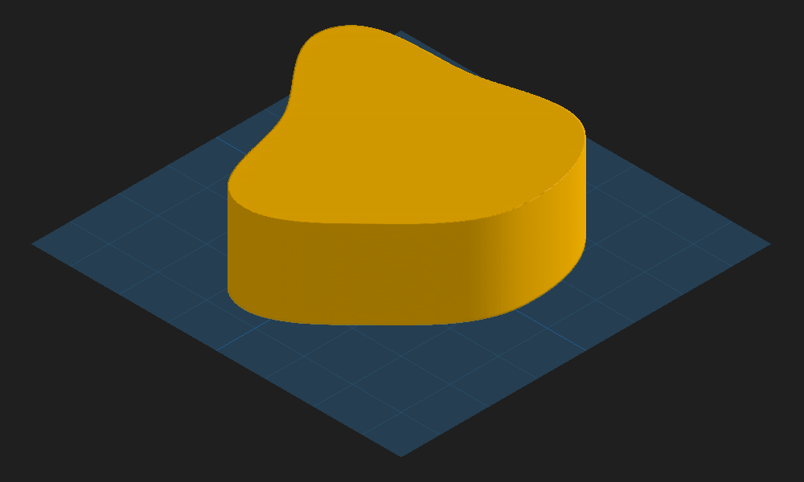

### Primitives

Creates box, sphere, cylinder, and torus SDF objects with interactive dimensions and positioning. Objects can be combined with Add, Subtract, and Intersection booleans. These are evaluated on the distance field, so they don't rely on edge-intersection solvers, and a join can be given a smooth blend radius.

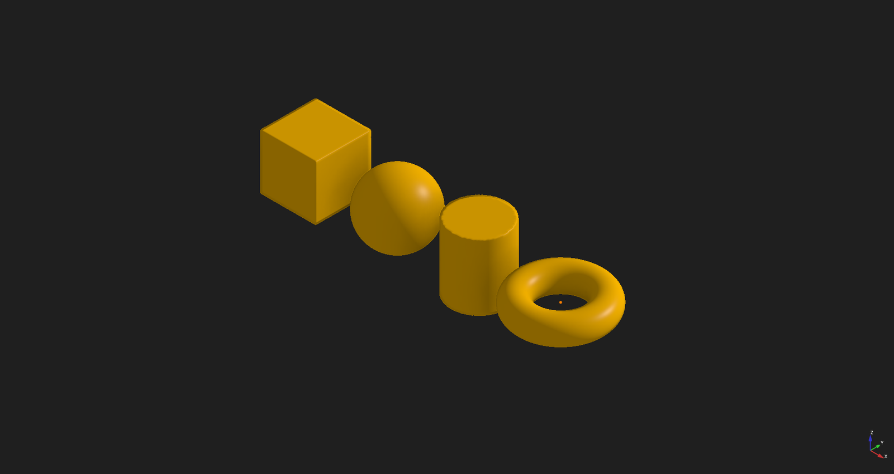

### Noise

Pushes the surface of an SDF object in and out along a direction you set with the gizmo. Choose from Waves, Square, Sawtooth, Perlin and Voronoi patterns, in 2D or 3D. The 2D patterns affect the side of the object facing the direction arrow. The 3D patterns wrap around every face. Amplitude and wavelength update in real time, and custom patterns can be built in the node graph editor.

### Twist

Twists an SDF object about an axis. 

### Bend

Bends an SDF object about an axis. Choose the axis (X, Y, or Z), the bend angle, and where along the axis the bend is centred.

### Lattice

Encloses a solid in a lattice of control points. Moving the points deforms the solid smoothly, which suits tapering, flaring, and shearing a form without changing the original.

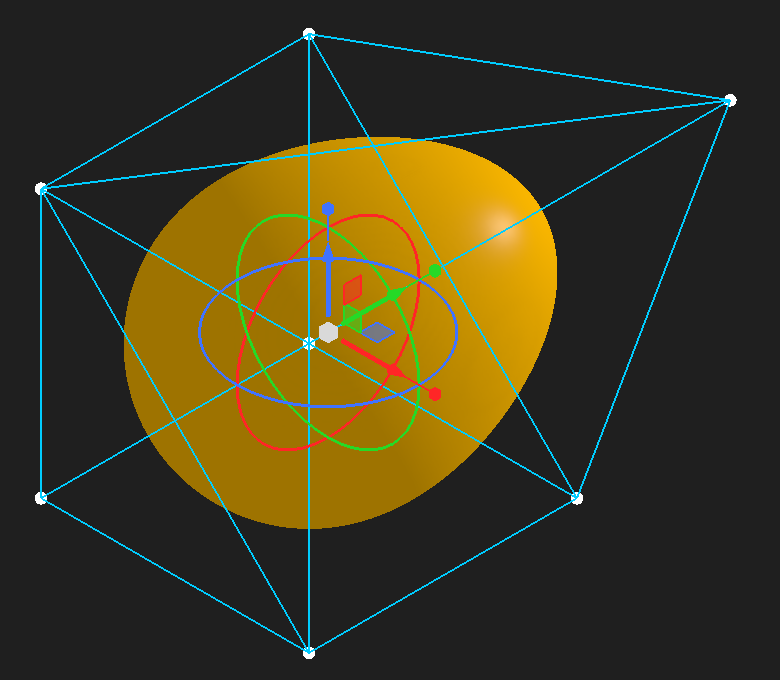

### Cage Deform

Encloses any SDF solid within an interactive 3D control cage. Extrude faces, insert edge loops, and move cage vertices to deform the underlying volume.

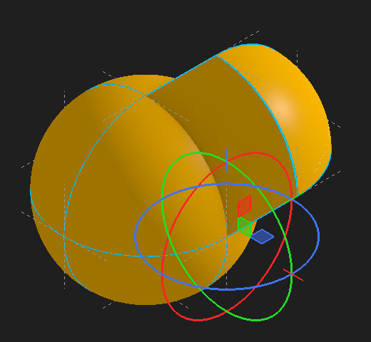

### Panel

Cuts a solid into flat boards stacked along an axis. 

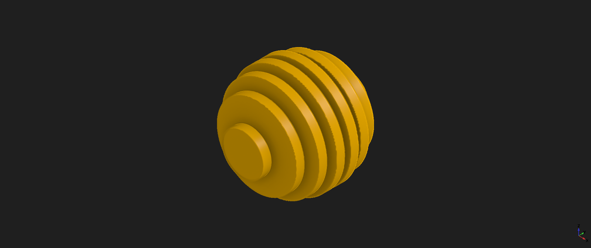

### Voxel Sculpt

Converts an SDF solid into an editable voxel volume that you can add and carve using 3D brushes. Use it for freeform digital clay sculpting with adjustable brush radius, strength, and falloff.

### Matcap Shading

Sets how a Fields object is shaded in the viewport. A matcap is a captured material that is looked up by surface angle, so an object keeps the same look from any viewing direction. The built-in set includes clay, studio, metal, and gold, plus diagnostic views such as zebra stripes and curvature.

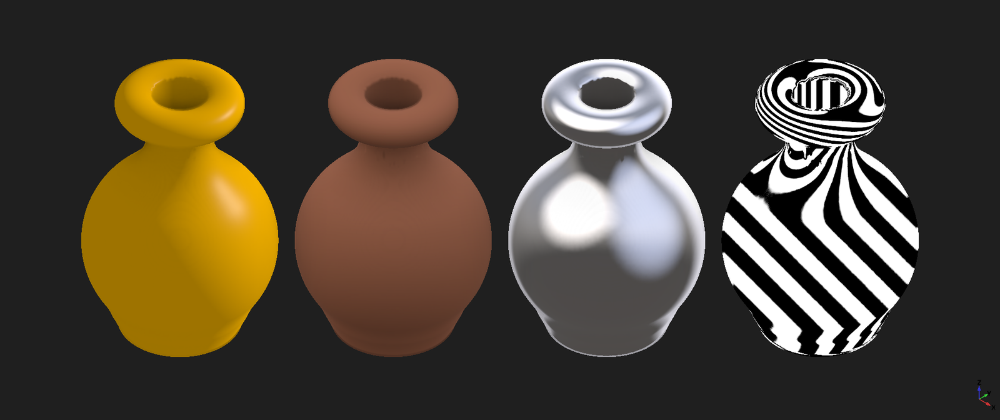

### SDF to Shape

Creates a Part solid from implicit fields using Surface Nets, Marching Cubes, or Dual Contouring. Use FreeCAD's standard export to save STL/OBJ files for 3D printing or downstream solid modeling.

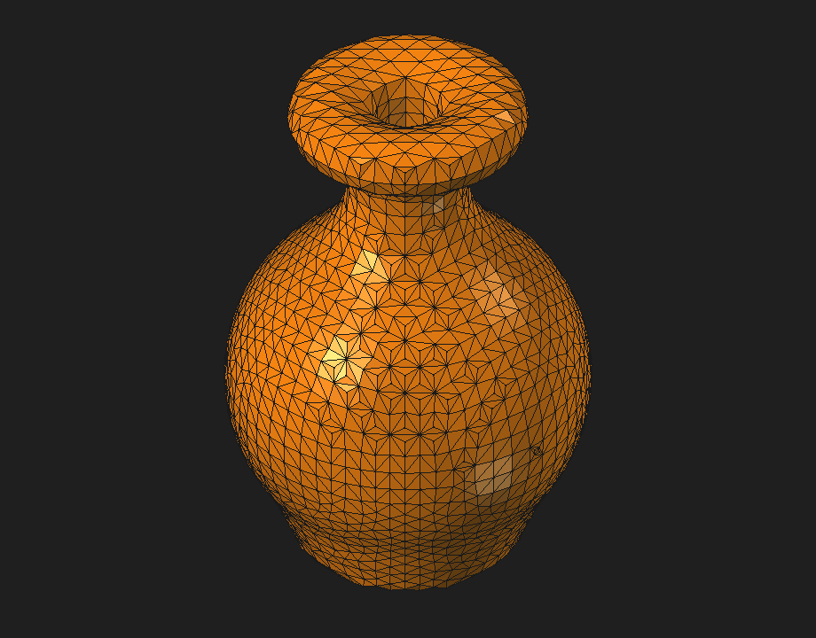

### Slice SDF

Cuts an SDF object with a plane and creates the cross-section as native FreeCAD BSplineCurves. A single plane or an array of parallel planes can be sliced at once, set by count or by spacing. The curves are suited to profile extraction, laser cutting, and CNC toolpaths, and can be used in Sketcher and Part workflows.

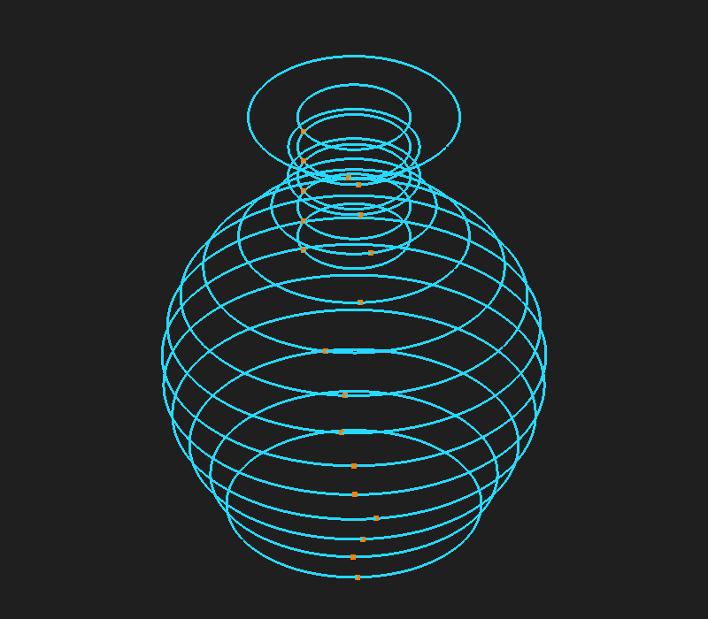

## Requirements

- FreeCAD 26.3 or newer

## Installation

**Manual:** Clone or download https://github.com/StevePeters-US/Freecad-Fields-Workbench into the `Mod` folder of your FreeCAD user data directory (the Python console prints it: `App.getUserAppDataDir()`). Name the folder `Fields`, then restart FreeCAD.

### Mouse and keyboard

1. **Editing:** double-click an object in the 3D viewport to edit it; `Enter` accepts and commits changes, `Esc` cancels.
2. **Right-click:** opens the active tool's context menu. Every tool shortcut is listed on its menu item, with its key shown.
3. **Gizmo:**
   - Drag a handle to move, rotate, or scale.
   - Hold `Ctrl` while dragging to snap to increments.
   - `Ctrl + Wheel` changes the snap step increment.
   - Type digits (`0`–`9`, `.`, `-`) to enter an exact value, `Tab` for the next value component, `Enter` to accept, and `Esc` to step back.
4. **Creating:** the same numeric keys type an exact size while dragging out a primitive shape.
5. **Command keys:**
   - `P`: Point
   - `W`: Work Plane
   - `Ctrl+F`: Fill Curve
   - `S, K`: Sketcher
6. **Tool-specific shortcuts:**
   - **Cage Editor:** `E` (Extrude Face), `Ctrl+R` (Insert Edge Loop), `Ctrl+D` (Subdivide), `M` (Weld), `Alt+Z` (Toggle X-ray), `Return` (Commit Extrusion), `Esc` (Cancel Extrusion)
   - **Sculpt Brush:** `[` (Smaller Brush), `]` (Larger Brush)
   - **Curve Editor:** `Del` (Delete selected points)
   - **Selection:** `Shift+A` (Select All)

## Known issues

- Active development: tools, underlying data structures, and file formats may change between releases. Backwards compatibility is not guaranteed across updates.
- Lattice and Cage Deform, Voxel Sculpt, and SDF to Shape are experimental.
- To report a bug, open an issue at https://github.com/StevePeters-US/Freecad-Fields-Workbench/issues and include your FreeCAD version (Help → About FreeCAD → Copy to clipboard), the steps to reproduce it, the relevant lines from `Fields.log` (in your FreeCAD user data directory), and a small `.FCStd` file that shows it.

## Support

If you find this workbench useful, consider supporting its development on [Patreon](https://www.patreon.com/cw/AttackPotato).

## License

CC BY-NC-SA 4.0 — see [LICENSE](LICENSE).

## Attributions

- **Inigo Quilez** ([iquilezles.org](https://iquilezles.org/)) — Foundational mathematical formulations for distance primitives, GLSL raymarching algorithms, and smooth boolean operators (`smoothMin`/`smoothMax`).
